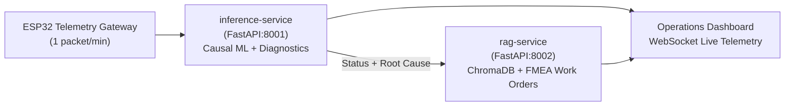

# AgriPulse — Predictive Maintenance & AI Assistant for Irrigation Pumps

[](#)
[](#)
[](#)
[](#)

> **AgriPulse** is an industrial-grade, end-to-end predictive maintenance and automated work-order generation platform tailored for **Horizontal End-Suction Centrifugal Irrigation Pumps** (Grundfos NB / Kirloskar DB Series).
> 
> The platform combines **causal streaming anomaly detection (ExtraTrees ML)**, **physics-informed multivariate signature diagnostics**, and a **domain-specific RAG assistant** backed by ISO 10816 and pump FMEA manuals to alert operators 30–120 minutes prior to catastrophic failure.

---

## 1. Target Machine & Physical Instrumentation (Core-7)

The system monitors an electric motor-driven centrifugal irrigation pump operating continuously under agricultural duty cycles:

```
       [ELECTRIC MOTOR]               [COUPLING]              [PUMP VOLUTE]
   +-----------------------+              ||              +-------------------+
   |                       |              ||              |     Impeller      |
   | [sensor_05 / 11]      |         [sensor_13]          |                   |====> Discharge Line
   | Motor Phase Currents  |      Coupling Vibration      |                   |      
   |                       |                              | [sensor_28]       |
   | [sensor_00]           |                              | Discharge Flow    |
   | Motor DE Bearing Vib  |                              +-------------------+
   |                       |                                        |
   | [sensor_40]           |                                        | Suction Line
   | Motor DE Bearing Temp |                                        v
   +-----------------------+
```

| Sensor ID | Mounting Location | Monitored Phenomenon | Governing Standard |
| :--- | :--- | :--- | :--- |
| **`sensor_00`** | Motor Drive-End (DE) Bearing | Radial Vibration Velocity (RMS mm/s) | **ISO 10816-3 Class II** (> 4.5 mm/s Warning) |
| **`sensor_04`** | Motor Output Shaft Collar | Rotational Shaft Speed (RPM) | Slip % against rated synchronous speed |
| **`sensor_05`** | Motor Feeder Cable (Phase A) | Current Draw (Amperes RMS) | **IEC 60034-1** Full Load Amperes (FLA) |
| **`sensor_11`** | Motor Feeder Cable (Phase B) | Phase Balance Current (Amperes) | **NEMA MG 1** Phase Imbalance (< 3%) |
| **`sensor_13`** | Flexible Coupling Guard | Axial Vibration Velocity (RMS mm/s) | **ISO 10816-3** Dynamic Axial Deflection |
| **`sensor_28`** | Discharge Flange Manifold | Hydraulic Flow Rate (L/min) | **ANSI/HI 9.6.1** Cavitation Margin |
| **`sensor_40`** | Bearing Housing Outer Surface | Bearing Temperature (°C) | SKF Limits (> 75°C Warning, > 85°C Critical) |

---

## 2. Platform Microservices Architecture



### Services Breakdown:
* **`services/inference/` (Port 8001):**
  - Stateful engine maintaining 65-reading causal buffer per pump asset.
  - Computes 28 causal rolling features with strict `shift(1)` temporal safety.
  - Multi-sensor Cosine Signature Matching against engineering failure modes.
  - Outputs real-time **Health Index (0–100%)**, **Risk Probability**, and **Sensor Contributions**.
* **`services/rag/` (Port 8002):**
  - Indexes specialized FMEA engineering manuals (Coupling, Bearings, Overload, Cavitation).
  - Generates ISO-compliant, technician-ready **Maintenance Work Orders** with step-by-step checklists, exact spare parts (e.g., SKF 6308, Spider 110), and urgency classifications.
* **`docs/`:**
  - Official engineering documentation, CAD instrumentation blueprints, hardware BOM, and academic thesis references.

---

## 3. Quick Start & Cloud Deployment

### Run via Docker Compose (Recommended)

```bash
# Clone the repository
git clone https://github.com/tasneem33355/AgriPulse.git
cd AgriPulse

# Build and start all microservices
docker-compose up --build -d
```

### Verification Endpoints:
* **Inference Service Health:** `GET http://localhost:8001/health`
* **Inference API Docs:** `http://localhost:8001/docs`
* **RAG Service Health:** `GET http://localhost:8002/health`
* **RAG API Docs:** `http://localhost:8002/docs`

---

## 4. Live Telemetry API Example

```bash
curl -X POST "http://localhost:8001/predict" \
     -H "Content-Type: application/json" \
     -d '{
       "pump_id": "PUMP_IRRIGATION_001",
       "timestamp": "2024-03-15T10:30:00Z",
       "sensor_00": 1.85,
       "sensor_04": 2940.0,
       "sensor_05": 14.8,
       "sensor_11": 14.7,
       "sensor_13": 5.42,
       "sensor_28": 185.0,
       "sensor_40": 48.6
     }'
```

### Sample Response:
```json
{
  "pump_id": "PUMP_IRRIGATION_001",
  "status": "CRITICAL",
  "health_index_pct": 43.0,
  "risk_score": 0.342,
  "attributed_sensor": "sensor_13",
  "primary_diagnosis": {
    "fault_code": "COUPLING_MISALIGNMENT",
    "title": "Flexible Coupling Misalignment & Spider Wear",
    "confidence_pct": 56.0,
    "iso_standard": "ISO 10816-3 Class II (Axial Vibration Severity > 4.5 mm/s)",
    "urgency": "CRITICAL"
  },
  "sensor_contributions_pct": {
    "sensor_13": 57.4,
    "sensor_00": 20.8,
    "sensor_40": 11.9
  }
}
```

---

## 5. Repository Structure

```
AgriPulse/
├── docker-compose.yml
├── README.md
├── docs/
│   ├── AI_Technical_Architecture.md
│   ├── AI_Pipeline_Completion_Plan.md
│   ├── Hardware_Team_Reference.md
│   └── Target_Machine_and_Sensor_Instrumentation_Guide.pdf
└── services/
    ├── inference/
    │   ├── Dockerfile
    │   ├── requirements.txt
    │   ├── app/
    │   │   ├── main.py
    │   │   ├── engine.py
    │   │   ├── diagnostics.py
    │   │   ├── schemas.py
    │   │   └── config.py
    │   └── models/
    │       └── model_config.json
    └── rag/
        ├── Dockerfile
        ├── requirements.txt
        ├── app/
        │   ├── main.py
        │   └── generator.py
        └── knowledge_base/
            └── fmea/
```

---

## 6. License & Academic Attribution
Developed for the **Smart Irrigation Pump Predictive Maintenance Graduation Thesis Project (2026)**.
All engineering parameters adhere to international condition monitoring standards (**ISO 10816-3** & **ANSI/HI 9.6**).
