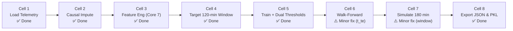
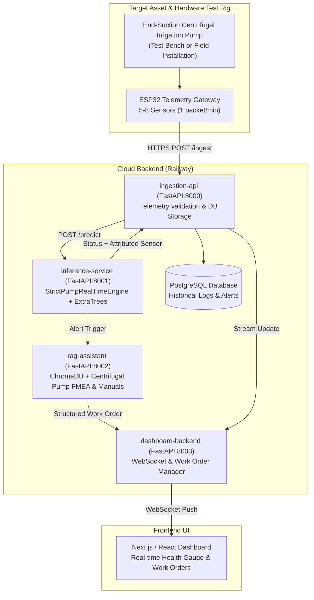

# AI System — Complete Pipeline & Completion Plan

> **Target Asset:** Industrial End-Suction Centrifugal Irrigation Pump (Standard: Grundfos NB / Kirloskar DB Series)
> **Document Purpose:** Engineering roadmap connecting model finalization, microservices, RAG, and physical test bench.
> **Version:** 2.0 — Standardized Architecture
> **Audience:** AI Team, Backend Team, Frontend Team

---

## Part 1 — Where We Are Now (Notebook State)

### Pending Notebook Fixes (Both Minor & Non-Breaking)

| Cell | Issue | Action Required |
| :--- | :--- | :--- |
| **Cell 6** | `d_te` references potentially lingering `t_te_end` | Replace with direct slice `d_te = clean_df[(clean_df["timestamp"] >= t_cal) & (clean_df["timestamp"] <= t_te)].copy().reset_index(drop=True)` |
| **Cell 7** | Simulation window is 90 mins (insufficient for 61-min warm-up + full 120-min failure window) | Change `pd.Timedelta(minutes=90)` to `pd.Timedelta(minutes=180)` |

---

## Part 2 — Full Production Architecture (Microservices)

---

## Part 3 — Core Microservices Implementation

### 3.1 `inference-service` (Port 8001)
Contains the exact serialized pipeline trained in the notebook:
- **Model:** `pump_engine_strict.pkl` (ExtraTrees Classifier trained on Core 7 sensors).
- **Configuration:** `model_config.json` containing:
  - Warning Threshold: `0.2713`
  - Critical Threshold: `0.3169`
  - Core Sensor Set: `["sensor_00", "sensor_04", "sensor_05", "sensor_11", "sensor_13", "sensor_28", "sensor_40"]`
- **Memory Buffer:** Maintains a 65-reading rolling FIFO window per pump ID.
- **Warm-Up:** First 61 minutes report status `INITIALIZING` to build stable 15-min and 60-min trend baselines.

### 3.2 `rag-assistant` (Port 8002)
Contains the pump-specific maintenance knowledge base:
- **Standards:** ISO 10816-3 (Vibration Severity for Class II Pumps), ANSI/HI 9.6 (Centrifugal Pumps).
- **Manuals:** Standard Centrifugal Irrigation Pump Operation & Maintenance Manuals.
- **FMEA Tables:**
  - Coupling Misalignment & Spider Wear (`sensor_13`).
  - Bearing Lubrication Starvation & Ball Defect (`sensor_00`, `sensor_40`).
  - Impeller Clogging & Motor Current Overload (`sensor_05`, `sensor_11`).
  - Hydraulic Cavitation & Suction Strainer Blockage (`sensor_28`, `sensor_48`).

---

## Part 4 — Step-by-Step Execution Plan

| Stage | Task | Deliverable |
| :---: | :--- | :--- |
| **Phase 1** | Apply minor fixes in Cells 6 & 7 in Kaggle; run **Restart & Run All** | Verified `pump_engine_strict.pkl` & `model_config.json` |
| **Phase 2** | Initialize `inference-service` repo with Dockerfile & FastAPI wrapper | Live `/predict` endpoint on Railway |
| **Phase 3** | Initialize `ingestion-api` repo with PostgreSQL schemas | Database tables for telemetry & alerts |
| **Phase 4** | Build `rag-assistant` with ChromaDB vector store + FMEA markdown chunks | Automated Work Order generation on WARNING/CRITICAL |
| **Phase 5** | Connect ESP32 Hardware Prototype to Ingestion endpoint | Real physical telemetry flowing into the AI engine |
| **Phase 6** | End-to-end rehearsal with Replay Stream Script | 6-minute live simulation of Event 6 for defense presentation |
