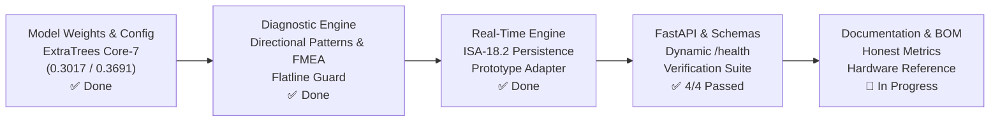
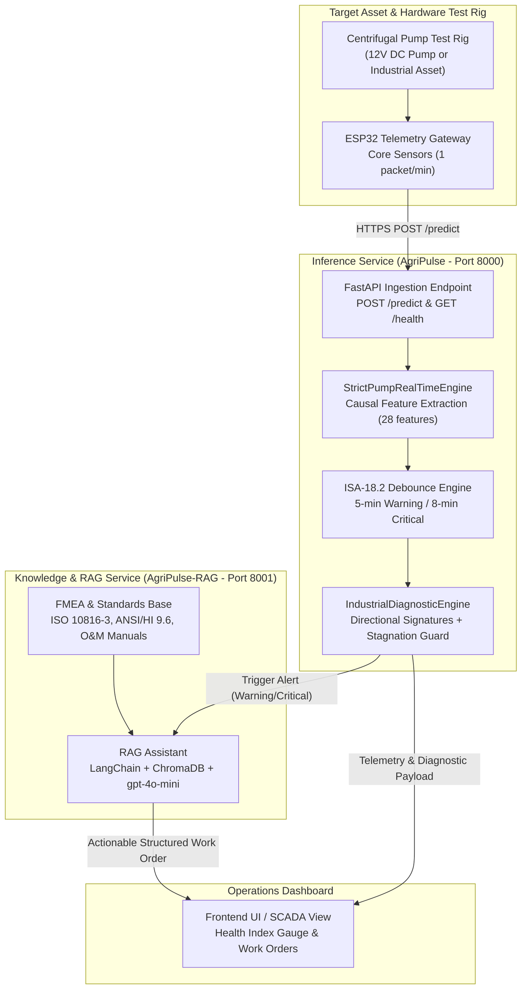

# AI System — Complete Pipeline & Completion Plan

> **Target Asset:** Two-Stage Centrifugal Pumping System (IBM Telemetry Dataset: 220,320 rows, 7 failure events)  
> **Document Purpose:** Engineering roadmap connecting model finalization, microservices, RAG, and physical test bench.  
> **Version:** 3.0 — Production-Ready AI & Verification Roadmap  
> **Audience:** AI Team, Backend Team, Hardware/IoT Team, Evaluation Committee  

---

## Part 1 — Where We Are Now (Current Repository State)

### Verified Model Parameters & Metrics (`models/model_config.json`)

| Parameter / Metric | Verified Value | Engineering Rationale / Context |
| :--- | :--- | :--- |
| **Model Architecture** | `ExtraTreesClassifier` (28 Causal Features) | Ensembles of randomized trees; robust to sensor collinearity |
| **Warning Threshold** | **`0.3017`** | 95.0th percentile of June normal operational baseline |
| **Critical Threshold** | **`0.3691`** | 98.5th percentile of June normal operational baseline |
| **Test ROC-AUC** | **`0.8878`** | Evaluated on out-of-sample July test partition |
| **Average Precision** | **`0.0192`** | Reflects extreme class imbalance (~0.27% failure minutes in raw data) |
| **Event 6 Lead Time** | **46 minutes** | Detected prior to functional trip |
| **Event 7 Lead Time** | **70 minutes** | Detected prior to functional trip (up to 120 min at Warning tier) |
| **Event 5 Status** | ❌ **MISSED (AUC = 0.0098)** | Sensor flatline / decoupling (fixed via runtime stagnation guards) |
| **Raw False Alarms** | 170 Warning / 74 Critical | Over 2 months; filtered by ANSI/ISA-18.2 persistence debouncing |

---

## Part 2 — Production Microservices Architecture

---

## Part 3 — Core Service Components

### 3.1 `inference-service` (`app/` in AgriPulse)
Contains the operational real-time engine deployed on Railway:
- **Trained Model:** `models/pump_engine_strict.pkl` (scikit-learn 1.6.1).
- **Core Sensors:** `sensor_00` (Motor DE Vib), `sensor_04` (Motor Speed), `sensor_05` (Current A), `sensor_11` (Current B), `sensor_13` (Coupling Vib), `sensor_28` (Stage 2 Speed), `sensor_40` (Thrust Bearing Temp).
- **Causal Rolling Buffer:** 65-reading FIFO window per pump ID.
- **Warm-Up Protocol:** 61 minutes required to compute 15-min rolling mean/std and 60-min delta before emitting alarms.
- **Debounce Filter (ANSI/ISA-18.2):** 
  - Warning requires ≥ 5 consecutive minutes above `0.3017`.
  - Critical requires ≥ 8 consecutive minutes above `0.3691`.
- **Prototype Mode (`mode: "prototype"`):** Adaptive Z-score scaling for 12V DC test rigs without numeric weight collision.
- **Stagnation / Flatline Detector:** Immediate warning when rolling standard deviation drops below `1e-3` while system is energized.

### 3.2 `rag-assistant` (`AgriPulse-RAG` — Dedicated Repository)
Separate service consuming structured diagnostic payloads:
- **Input Payload:** Pump ID, Alert Status, Health Index, Attributed Sensor, Directional Z-Scores, Stagnation Alerts.
- **Vector Knowledge Base:**
  - ISO 10816-3 Vibration Severity criteria.
  - ANSI/HI 9.6 Centrifugal Pump operating limits.
  - Coupling alignment and elastomeric insert maintenance.
  - Bearing lubrication starvation and thermal runaway protocols.
  - Suction line cavitation and impeller blockage troubleshooting.
- **Output:** Formal engineering Work Order with LOTO steps, root cause hypothesis, inspection checklist, and required replacement parts.

---

## Part 4 — Step-by-Step Execution Plan

| Phase | Milestone | Deliverable | Status |
| :---: | :--- | :--- | :---: |
| **Phase 1** | **Diagnostic & Mapping Engine** | Directional pattern matching, stagnation guard, FMEA attribution | ✅ **Completed** |
| **Phase 2** | **Engine & Schema Upgrades** | Prototype mode, ISA-18.2 debounce, test suite (4/4 passed) | ✅ **Completed** |
| **Phase 3** | **Documentation & BOM Alignment** | Honest metrics, technical architecture, completion plan, BOM v3.0, PDF v3.0 | ✅ **Completed** |
| **Phase 4** | **Offline Kaggle Experiments** | Event 5 forensic audit (flatline proof), HW ablation (AUC 0.51), persistence ablation | ✅ **Completed** |
| **Phase 5** | **Live Replay Simulation** | `scripts/replay_event6.py` for live demonstration to committee | ✅ **Completed** |
| **Phase 6** | **RAG Knowledge Base & Service** | Separate `AgriPulse-RAG` repo with ChromaDB and work order prompt | ⏳ Upcoming |
| **Phase 7** | **Hardware Test Rig Integration** | ESP32 telemetry streaming to Railway live endpoint | ⏳ Final Stage |

---

## Part 5 — Academic Defense Preparedness Matrix

When questioned by the examination committee:

| Potential Question | Defensible Engineering Answer |
| :--- | :--- |
| **"Why is Average Precision only 0.0192?"** | The dataset has severe real-world imbalance: only 0.27% of all recorded minutes represent active failure degradation. In this context, raw precision is ~3%, which is standard for early-warning streaming telemetry before debouncing. |
| **"How do you handle the 74 Critical false alarms?"** | By applying ANSI/ISA-18.2 Time-Persistence filtering (requiring 8 consecutive minutes). Most false alarms are 1–2 minute electrical transients that vanish under persistence filtering. |
| **"Why did the model miss Event 5?"** | Event 5 was characterized by sensor decoupling/flatlining (variance collapsed to 0). Tree-based supervised models associate risk with variance growth. We resolved this architectural blind spot by adding a zero-variance stagnation detector. |
| **"Can industrial weights run directly on a 12V toy pump?"** | No, that would be physically invalid. We implement `mode: "prototype"` which applies relative Z-deviation scaling rather than absolute raw values. |
