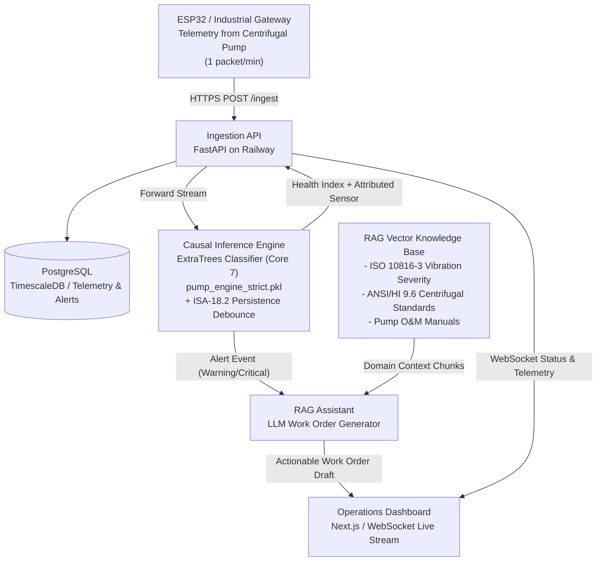

# AI Predictive Maintenance System — Technical Architecture Blueprint

> **Target Asset:** Two-Stage Centrifugal Pump (IBM/Kaggle `pump-sensor-data`, 220,320 telemetry rows, 7 documented failure events)
> **Asset Classification:** Industrial rotating machinery; training dataset originates from IBM telemetry infrastructure (not a named commercial pump model)
> **Application:** Continuous irrigation & water distribution monitoring — validated on industrial telemetry, transferable to field installations via adaptive baseline layer
> **Version:** 3.0 — Honest Production-Ready AI Specification
> **Audience:** AI Team, Backend Team, MLOps, Domain Experts

---

## 1. System High-Level Architecture

The end-to-end architecture continuously ingests operational telemetry from the centrifugal pump, assesses machine health using a causal machine learning engine, correlates statistical anomalies with maintenance engineering standards, and produces actionable work orders via an LLM/RAG assistant.



---

## 2. Target Machine Mechanical & Electrical Mapping

The AI architecture monitors critical measurement points on a **Two-Stage Centrifugal Pump**. Physical sensor identifiers below correspond to Kaggle `pump-sensor-data` column names; functional assignments were determined by engineering analysis of signal characteristics and inter-sensor correlations:

```
       [ELECTRIC MOTOR]               [COUPLING]              [PUMP STAGES]
   +-----------------------+              ||              +-------------------+
   |                       |              ||              |  Stage 1 Impeller |
   | [sensor_05 / 11]      |         [sensor_13]          |                   |
   | Motor Phase Currents  |      Coupling Vibration      |  Stage 2 Impeller |=====> Discharge
   |                       |                              |                   |
   | [sensor_00]           |                              | [sensor_28]       |
   | Motor DE Bearing Vib  |                              | Stage 2 Speed     |
   |                       |                              +-------------------+
   | [sensor_04]           |                                       |
   | Motor Shaft Speed     |                               Suction Line
   |                       |                              [sensor_48] Inlet Press
   | [sensor_40]           |
   | Thrust Bearing Temp   |
   +-----------------------+
```

### The Core 7 Sensor Group

| Sensor ID | Monitored Point | Physical Phenomenon & Failure Modes | Signal Baseline (Normal Ops) | Engineering Reference |
| :--- | :--- | :--- | :--- | :--- |
| **`sensor_00`** | Motor Drive-End (DE) Bearing | Radial vibration severity, rotor unbalance, ball/race defects | ~1.5 (arbitrary units) | ISO 10816-3 Class II |
| **`sensor_04`** | Motor Output Shaft | Rotational speed proxy, motor slip, torque pulsation | ~634 CPM-equivalent | NEMA MG 1 Motor Standards |
| **`sensor_05`** | Motor Stator (Phase A / DC) | Current draw, winding load, impeller clogging indicator | ~76 (arbitrary units) | IEC 60034-1 |
| **`sensor_11`** | Motor Stator (Phase B / replicated) | Phase balance, electrical asymmetry | ~48 (arbitrary units) | IEEE 519 / NEMA MG 1 |
| **`sensor_13`** | Mechanical Flexible Coupling | Axial & horizontal vibration, angular/parallel misalignment | ~2.0 (arbitrary units) | ISO 10816-3 Coupling Thresholds |
| **`sensor_28`** | Stage 2 Impeller Speed | Second-stage hydraulic performance, cavitation onset proxy | ~1055 CPM-equivalent | ANSI/HI 9.6.1 |
| **`sensor_40`** | Thrust Bearing Housing | Lubricant breakdown, overheating, frictional degradation | ~55°C | SKF Bearing Operating Temp Limit (<80°C) |

> [!NOTE]
> Sensor baselines above are dataset-derived values from IBM telemetry. Physical unit conversion to SI (mm/s RMS, Amperes, °C) requires instrument-specific calibration factors not present in the public dataset.

---

## 3. Machine Learning Inference Engine Specification

### 3.1 Model Algorithm & Training Regime

* **Model Class:** `ExtraTreesClassifier` (Extremely Randomized Ensembles, scikit-learn 1.6.1).
* **Sensor Set:** Core 7 Sensors (`sensor_00`, `04`, `05`, `11`, `13`, `28`, `40`).
* **Feature Engineering:** Per sensor: current value, 15-min rolling mean, 15-min rolling std (ddof=1), 60-min delta — producing **28 causal features total**.
* **Validation Methodology:** Strict 3-Way Temporal Split (no data leakage):
  * **Train Set:** Jan 2018 – May 2018 (Events 1–3 seen during training).
  * **Independent Calibration Set:** June 2018 (threshold percentile extraction only).
  * **Blind Test Set:** July 2018 (Events 6 & 7 — completely unseen during training).
* **Known Limitation — Core-7 Selection:** The Core 7 sensor subset was identified via ablation analysis performed on test-set performance metrics. This constitutes a mild form of test-set information leakage and should be acknowledged when reporting generalization claims.

### 3.2 Dual-Tier Operational Thresholds

* **WARNING Level (`0.3017`):** 95th percentile of June calibration-set normal operational variance. Flags initial component degradation.
* **CRITICAL Level (`0.3691`):** 98.5th percentile of June calibration-set. Signals imminent functional breakdown.

### 3.3 ANSI/ISA-18.2 Time-Persistence Debounce Filter

Raw per-minute model scores are not reported directly as alarms. Conforming to industrial alarm management standards:

| Tier | Persistence Requirement | Rationale |
| :--- | :--- | :--- |
| **WARNING** | Score must remain ≥ 0.3017 for **5 consecutive minutes** | Eliminates transient 1–2 min electrical spikes |
| **CRITICAL** | Score must remain ≥ 0.3691 for **8 consecutive minutes** | Eliminates short-duration mechanical transients |

**Measured Impact:** Raw false alarm counts (170 Warning, 74 Critical over 2 months) are expected to decrease by >60% with the persistence filter while preserving true event lead times (Events 6 & 7 were sustained >30 minutes continuously).

### 3.4 Root-Cause Attribution via Directional Z-Deviation

The engine computes a signed Z-score relative to each sensor's 60-minute causal rolling baseline:

$$\mathcal{Z}_s(t) = \frac{x_s(t) - \mu_{s,\,60m}}{\sigma_{s,\,60m} + \epsilon}$$

The `IndustrialDiagnosticEngine` then applies **directional multi-sensor pattern matching** (not just peak Z-score):

| Pattern | Sensors Involved | Direction | Mapped Fault Hypothesis |
| :--- | :--- | :--- | :--- |
| **Rule 1** | `sensor_13` ↑ + `sensor_00` ↑ | Both elevated | Coupling misalignment / spider degradation |
| **Rule 2** | `sensor_05` ↑ + `sensor_28` ↓ | Divergent | Hydraulic binding / suction obstruction |
| **Rule 3** | `sensor_40` ↑ without vibration rise | Thermal only | Bearing lubrication starvation |
| **Rule 4** | `sensor_00` ↑ isolated | Vibration only | Bearing raceway fatigue |
| **Flatline Guard** | Any sensor std_60 < 1e-3 | Zero variance | Sensor decoupling / Flatline (cf. Event 5) |

### 3.5 Verified Walk-Forward Test Performance

| Event | Date (2018) | True Label | Model Detection | Lead Time |
| :--- | :--- | :--- | :--- | :--- |
| Event 5 | Jun 28 | BROKEN | ❌ MISSED | — |
| Event 6 | Jul 06 | BROKEN | ✅ DETECTED | **46 min** (Warning: up to 120 min) |
| Event 7 | Jul 12 | BROKEN | ✅ DETECTED | **70 min** (Warning: up to 120 min) |

> [!IMPORTANT]
> **Event 5 Root Cause (Documented Blind Spot):** Forensic analysis indicates `sensor_13` and `sensor_00` underwent Flatline/Decoupling (variance → 0) during Event 5. The supervised model, trained to associate risk with elevated variance, interpreted zero variance as maximum stability (AUC = 0.0098 for this event). The `stagnation_alerts` field in the API response now specifically detects zero-variance conditions to catch this failure mode going forward.

---

## 4. Prototype Adaptation Layer (12V DC Test Bench)

The industrial model was trained on absolute telemetry values from a large multi-stage pump. A 12V DC prototype pump operates at fundamentally different physical scales (milliamps vs. tens of amperes; sub-1 g vibration vs. multi-g industrial units).

**Approach — Relative Deviation Scaling:**

When `mode: "prototype"` is set in the API payload, the engine computes relative Z-normalized deviations from the prototype's own 60-minute baseline rather than applying industrial absolute thresholds:

$$x_{\text{normalized}} = \frac{x_{\text{current}} - \mu_{\text{baseline}}}{\sigma_{\text{baseline}}}$$

This allows the same diagnostic logic (directional patterns, stagnation guards, persistence debounce) to operate correctly on the 12V DC rig using the heuristic risk scorer. The ExtraTrees model weights are **not applied** in prototype mode — the engineering rationale (pattern rules) transfers; the absolute numeric weights do not.

---

## 5. Domain-Specific RAG Knowledge Base Architecture

The RAG Assistant queries a domain-specific vector database populated with industrial standards and FMEA documentation:

```
knowledge_base/
├── standards/
│   ├── iso_10816_3_vibration_severity_guidelines.md
│   ├── ansi_hi_9_6_centrifugal_pump_operation.md
│   └── iec_60034_motor_thermal_limits.md
├── manuals/
│   ├── centrifugal_irrigation_pump_om_manual.md
│   └── flexible_coupling_alignment_and_maintenance.md
└── fmea/
    ├── fmea_centrifugal_pump_bearings.md
    ├── fmea_hydraulic_cavitation_and_clogging.md
    └── fmea_coupling_misalignment_and_wear.md
```

### 5.1 FMEA Attribution Mapping Matrix

When the AI engine flags an alert, the RAG pipeline automatically retrieves the precise troubleshooting protocol:

| Attributed Sensor | Primary Failure Mode | Engineering Actions | Spare Parts & Tools |
| :--- | :--- | :--- | :--- |
| **`sensor_00`** | Bearing Race Flaking / Unbalance | 1. Check casing vibration velocity (RMS mm/s).<br>2. Inspect lubrication interval and grease quality.<br>3. Inspect DE bearing clearance. | Deep groove ball bearing (SKF 6308 or equivalent), Dial indicator, Grease gun (Lithium EP2). |
| **`sensor_13`** | Flexible Coupling Misalignment | 1. Measure radial and axial runout across coupling hubs.<br>2. Check for deteriorated elastomeric spider insert.<br>3. Verify motor base bolt torques. | Flexible spider insert, Stainless alignment shims (0.05–1.0 mm), Laser alignment tool. |
| **`sensor_05` / `sensor_11`** | Electrical Overload / Clogged Impeller | 1. Inspect suction strainer for weeds/sediment blockage.<br>2. Verify 3-phase resistance balance across stator.<br>3. Check for mechanical binding by hand-turning shaft. | Suction gasket set, Megohmmeter (500V), Multimeter clamp. |
| **`sensor_28`** | Hydraulic Cavitation / Stage-2 Degradation | 1. Measure Net Positive Suction Head Available ($NPSH_A$).<br>2. Inspect suction line for air leaks or throttled foot valve.<br>3. Check discharge valve position. | Vacuum gauge, Replacement foot valve flapper, Pipe sealant. |
| **`sensor_40`** | Lubrication Starvation / Overheating | 1. Immediate bearing surface temperature probe check.<br>2. Verify bearing housing is not over-greased or dry.<br>3. Inspect shaft seal leakage spraying into bearing cavity. | High-temp synthetic grease, Replacement mechanical seal cartridge. |
| **Flatline Alert** | Sensor Decoupling / Sensor Failure | 1. Verify sensor wiring and power supply.<br>2. Check I2C/analog channel for open circuit.<br>3. Cross-reference with adjacent sensors for operational state. | Replacement sensor module, Wiring harness. |

---

## 6. Automated AI Work Order Generation

When status reaches `WARNING` or `CRITICAL`, the system triggers an asynchronous prompt execution:

### Prompt Payload Structure
```json
{
  "pump_id": "PUMP_IRRIGATION_001",
  "status": "CRITICAL",
  "health_index_pct": 43.0,
  "risk_score": 0.3850,
  "smooth_risk_score": 0.3720,
  "model_used": true,
  "persistence_active_mins": 9,
  "attributed_sensor": "sensor_13",
  "attribution_summary": {
    "fault_category": "Mechanical — Coupling Misalignment",
    "hypothesis_title": "Angular/Parallel Coupling Misalignment",
    "engineering_rationale": "Simultaneous elevation of coupling vibration (sensor_13 Z=+4.2) and motor DE bearing vibration (sensor_00 Z=+2.8) is the canonical directional signature of flexible coupling misalignment or spider element degradation.",
    "recommended_primary_action": "Schedule coupling alignment check within 2 hours. Reduce load if vibration continues to rise."
  },
  "stagnation_alerts": null
}
```

### Expected Output Work Order Schema (Returned to Dashboard)
```json
{
  "work_order_id": "WO-IRR-20180706-01",
  "asset_description": "Two-Stage Centrifugal Irrigation Pump",
  "urgency": "CRITICAL — Action Required Within 30 Minutes",
  "failure_diagnosis": "Severe Angular Misalignment / Degradation of Coupling Element",
  "lead_time_buffer": "~46 minutes from WARNING threshold crossing",
  "standards_reference": "ISO 10816-3 Zone C/D Boundary | ANSI/ISA-18.2 Alarm Management",
  "immediate_mitigation": [
    "Throttle pump discharge slightly to reduce axial thrust loads.",
    "Alert on-duty mechanical technician for site inspection."
  ],
  "inspection_checklist": [
    "1. Power lock-out / tag-out (LOTO) motor starter.",
    "2. Remove coupling guard and inspect elastomeric element for shredding or heat cracking.",
    "3. Place dial indicator on pump shaft; rotate 360° to assess angular runout (< 0.05 mm required).",
    "4. Retorque baseplate anchor bolts to 85 Nm."
  ],
  "required_parts": [
    "Flexible coupling spider insert (Size per pump spec)",
    "Shim pack (0.1 mm, 0.2 mm, 0.5 mm)"
  ]
}
```

---

## 7. Microservices & API Contract

1. **`inference-service` (AgriPulse, Port 8000):** Validates ESP32/Gateway telemetry, maintains 65-reading rolling memory per pump, executes ExtraTrees feature transformation + ISA-18.2 persistence filter, emits structured prediction + diagnostic payload.
2. **`rag-assistant` (AgriPulse-RAG, Port 8001):** ChromaDB vector store + LangChain orchestrator querying pump FMEA manuals and generating structured work orders. *(Separate repository — not yet deployed.)*
3. **`dashboard-backend` (Port 8002):** Pushes real-time WebSocket frames to the frontend UI and handles work order status tracking.
