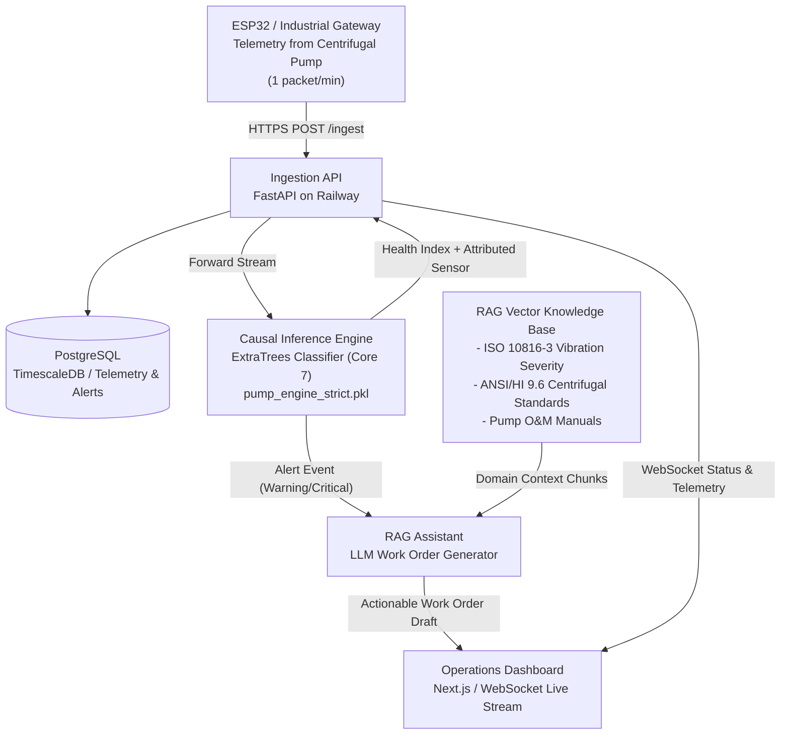

# AI Predictive Maintenance System — Technical Architecture Blueprint

> **Target Asset:** Industrial End-Suction Centrifugal Irrigation Pump (Standard: Grundfos NB / Kirloskar DB Series)
> **Asset Classification:** Class II Industrial Machinery under ISO 10816-3 (Medium-sized machines 15 kW to 75 kW on rigid foundations)
> **Application:** Continuous Irrigation & Water Distribution Station
> **Version:** 2.0 — Production-Ready AI & RAG Specification
> **Audience:** AI Team, Backend Team, MLOps, Domain Experts

---

## 1. System High-Level Architecture

The end-to-end architecture continuously ingests operational telemetry from the centrifugal pump, assesses machine health using a causal machine learning engine, correlates statistical anomalies with maintenance engineering standards, and produces actionable work orders via an LLM/RAG assistant.



---

## 2. Target Machine Mechanical & Electrical Mapping

The AI architecture monitors the exact critical points of a standard **End-Suction Centrifugal Irrigation Pump**:

```
       [ELECTRIC MOTOR]               [COUPLING]              [PUMP VOLUTE]
   +-----------------------+              ||              +-------------------+
   |                       |              ||              |     Impeller      |
   | [sensor_05 / 11]      |         [sensor_13]          |                   |====> Discharge Line
   | Motor Phase Currents  |      Coupling Vibration      |                   |      
   |                       |                              | [sensor_28]       |
   | [sensor_00]           |                              | Discharge Flow    |
   | Motor DE Bearing Vib  |                              +-------------------+
   |                       |                                        |
   | [sensor_40]           |                                        | Suction Line
   | Motor DE Bearing Temp |                                        v
   +-----------------------+
```

### The Core 7 Sensor Group:

| Sensor ID | Monitored Point on Pump Asset | Physical Phenomenon & Failure Modes Monitored | Engineering Standard Reference |
| :--- | :--- | :--- | :--- |
| **`sensor_00`** | Motor Drive-End (DE) Bearing | Radial vibration severity, rotor unbalance, ball/race defects | ISO 10816-3 Class II (Zone A to D) |
| **`sensor_04`** | Motor Output Shaft | Rotational speed (RPM), motor slip, torque pulsation | NEMA MG 1 Motor Standards |
| **`sensor_05`** | Motor Stator Feed (Phase A) | Current draw (Amperes), winding load, impeller clogging | IEC 60034-1 Electric Ratings |
| **`sensor_11`** | Motor Stator Feed (Phase B) | Phase balance, voltage sag, single-phasing detection | IEEE 519 / NEMA MG 1 |
| **`sensor_13`** | Mechanical Flexible Coupling | Axial & horizontal vibration, angular/parallel misalignment | ISO 10816-3 Coupling Thresholds |
| **`sensor_28`** | Pump Volute / Discharge Flange | Flow rate delivery proxy, hydraulic cavitation, air ingestion | ANSI/HI 9.6.1 Cavitation Margin |
| **`sensor_40`** | DE Bearing External Housing | Lubricant breakdown, overheating, frictional degradation | SKF Bearing Operating Temp Limit (<80°C) |

---

## 3. Machine Learning Inference Engine Specification

### 3.1 Model Algorithm & Training Regime
* **Model Class:** `ExtraTreesClassifier` (Extremely Randomized Ensembles).
* **Sensor Set:** Core 7 Sensors (`sensor_00`, `04`, `05`, `11`, `13`, `28`, `40`).
* **Validation Methodology:** Strict 3-Way Temporal Split:
  * **Train Set:** Fits decision trees exclusively on historical baseline operations.
  * **Independent Calibration Set:** Extracts operational percentiles without label leakage.
  * **Blind Test Set:** Completely untouched out-of-sample failure events.

### 3.2 Dual-Tier Operational Thresholds
* **WARNING Level (`0.2713`):** 95th percentile of normal operational variance. Flags initial component degradation (e.g., initial coupling jitter or minor cavitation).
* **CRITICAL Level (`0.3169`):** 98.5th percentile. Signals imminent functional breakdown requiring load reduction or controlled shutdown.

### 3.3 Root-Cause Attribution via Dynamic Z-Deviation
The engine computes a localized Z-score relative to each sensor's 60-minute rolling baseline:
$$\mathcal{Z}_s(t) = \frac{|x_s(t) - \mu_{s, 60m}|}{\sigma_{s, 60m} + \epsilon}$$
The sensor exhibiting the highest relative deviation $\max_s(\mathcal{Z}_s)$ is flagged as the **Attributed Sensor**. This pinpoints whether the failure is electrical (motor currents), mechanical (bearing/coupling vibration), or hydraulic (flow/pressure).

---

## 4. Domain-Specific RAG Knowledge Base Architecture

The RAG Assistant does not rely on generic LLM knowledge. It queries a domain-specific vector database populated with industrial standards and manuals for **End-Suction Centrifugal Pumps**:

```
knowledge_base/
├── standards/
│   ├── iso_10816_3_vibration_severity_guidelines.md
│   ├── ansi_hi_9_6_centrifugal_pump_operation.md
│   └── iec_60034_motor_thermal_limits.md
├── manuals/
│   ├── centrifugal_irrigation_pump_om_manual.md
│   └── flexible_coupling_alignment_and_maintenance.md
└── fmea/
    ├── fmea_centrifugal_pump_bearings.md
    ├── fmea_hydraulic_cavitation_and_clogging.md
    └── fmea_coupling_misalignment_and_wear.md
```

### 4.1 FMEA Attribution Mapping Matrix

When the AI engine flags an alert, the RAG pipeline automatically retrieves the precise troubleshooting protocol:

| Attributed Sensor | Primary Failure Mode Identified | Specific Engineering Actions (from RAG Manuals) | Spare Parts & Tools |
| :--- | :--- | :--- | :--- |
| **`sensor_00`** | Bearing Race Flaking / Unbalance | 1. Check casing vibration velocity (RMS mm/s).<br>2. Inspect lubrication interval and grease quality.<br>3. Inspect DE bearing clearance. | Deep groove ball bearing (SKF 6308 or equivalent), Dial indicator, Grease gun (Lithium EP2). |
| **`sensor_13`** | Flexible Coupling Misalignment | 1. Measure radial and axial runout across coupling hubs.<br>2. Check for deteriorated elastomeric spider insert.<br>3. Verify motor base bolt torques. | Flexible spider insert, Stainless alignment shims (0.05–1.0 mm), Laser alignment tool. |
| **`sensor_05` / `sensor_11`** | Electrical Overload / Clogged Impeller | 1. Inspect suction strainer for weeds/sediment blockage.<br>2. Verify 3-phase resistance balance across stator.<br>3. Check for mechanical binding by hand-turning shaft. | Suction gasket set, Megohmmeter (500V Insulation tester), Multimeter clamp. |
| **`sensor_28`** | Hydraulic Cavitation / Recirculation | 1. Measure Net Positive Suction Head Available ($NPSH_A$).<br>2. Inspect suction line for air leaks or throttled foot valve.<br>3. Check discharge valve position. | Vacuum gauge, Replacement foot valve flapper, Pipe sealant. |
| **`sensor_40`** | Lubrication Starvation / Overheating | 1. Immediate bearing surface temperature probe check.<br>2. Verify bearing housing is not over-greased or dry.<br>3. Inspect shaft seal leakage spraying into bearing cavity. | High-temp synthetic grease, Replacement mechanical seal cartridge. |

---

## 5. Automated AI Work Order Generation

When status reaches `WARNING` or `CRITICAL`, the system triggers an asynchronous prompt execution:

### Prompt Payload Structure
```json
{
  "pump_id": "PUMP_IRRIGATION_001",
  "status": "CRITICAL",
  "health_index_pct": 43.0,
  "risk_score": 0.342,
  "attributed_sensor": "sensor_13",
  "sensor_telemetry_snapshot": {
    "sensor_00_vib_de": 2.85,
    "sensor_13_vib_coupling": 5.42,
    "sensor_05_current_a": 16.2,
    "sensor_40_temp_c": 54.1
  },
  "retrieved_context": "[ANSI/HI 9.6.5 Coupling Misalignment Standards & Grundfos NB Maintenance Chapter 6]"
}
```

### Expected Output Work Order Schema (Returned to Dashboard)
```json
{
  "work_order_id": "WO-IRR-20180708-01",
  "pump_model": "Grundfos NB 65-200 End-Suction Centrifugal",
  "urgency": "CRITICAL — Action Required Within 30 Minutes",
  "failure_diagnosis": "Severe Angular Misalignment / Degradation of Coupling Element",
  "lead_time_buffer": "30 minutes remaining before functional trip",
  "standards_reference": "ISO 10816-3 Zone C/D Boundary Exceeded",
  "immediate_mitigation": [
    "Throttling pump discharge slightly to reduce axial thrust loads.",
    "Alert on-duty mechanical technician for site inspection."
  ],
  "inspection_checklist": [
    "1. Power lock-out / tag-out (LOTO) motor starter.",
    "2. Remove coupling guard and inspect elastomeric element for shredding or heat cracking.",
    "3. Place dial indicator on pump shaft; rotate 360° to assess angular runout (< 0.05 mm required).",
    "4. Retorque baseplate anchor bolts to 85 Nm."
  ],
  "required_parts": [
    "Flexible coupling spider insert (Size 110)",
    "Shim pack (0.1 mm, 0.2 mm, 0.5 mm)"
  ]
}
```

---

## 6. Microservices & API Contract

1. **`ingestion-api` (Port 8000):** Validates incoming ESP32/Gateway telemetry packets, writes raw records to PostgreSQL, and calls inference.
2. **`inference-service` (Port 8001):** Maintains 65-reading rolling memory per pump instance, executes ExtraTrees feature transformation, and emits predictions.
3. **`rag-assistant` (Port 8002):** ChromaDB vector store + LangChain orchestrator querying pump manuals and generating structured work orders.
4. **`dashboard-backend` (Port 8003):** Pushes real-time WebSocket frames to the frontend UI and handles work order status tracking.
